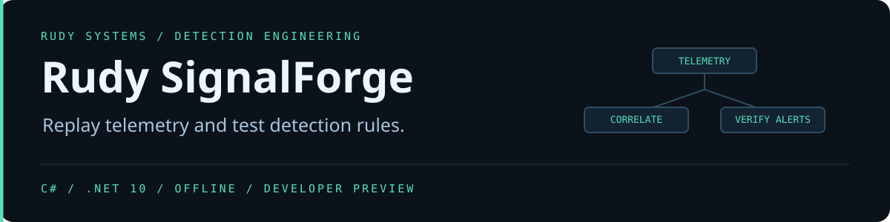

# Rudy SignalForge

Replay security telemetry and verify exactly which events caused each alert. SignalForge is an offline .NET library and CLI for testing detections before deployment. Rules use declarative JSON. Alerts preserve each matched event's source, ID, and UTC timestamp.

## Run the included case

Download the [preview](https://github.com/r4venrudy/rudy-signalforge/releases), verify its SHA-256 with the companion SHA256SUMS.txt, extract it, and use the .NET 10 runtime.

~~~sh
dotnet bin/signalforge.dll lint examples/rules.json
dotnet bin/signalforge.dll replay examples/rules.json examples/events.jsonl
dotnet bin/signalforge.dll test examples/rules.json examples/events.jsonl examples/expected.json
~~~

The fixture detects three authentication failures in 30 seconds for one account. A separate rule correlates an authentication session with an administrative role change on the same account and host. The test checks both alerts and their exact evidence IDs.

Use - in place of the event file to pass a normalized JSONL stream to replay or test.

## Author detections

Use one JSON object per event. Events are ordered by timestamp, then file order for ties. Each source and ID combination is unique within a capture. A timestamp includes Z or a numeric UTC offset. Fields use bounded string values. Normalize raw sensor exports to this input first.

~~~json
{"ts":"2026-11-14T11:00:00Z","source":"auth","id":"a1","fields":{"kind":"failed","account":"casey"}}
~~~

A rule has an ID, severity, type, grouping fields, window in seconds, and stages. Each stage is an array of predicates combined with logical AND. Predicates are case-sensitive and support eq, prefix, and exists. Use source as a predicate field for the top-level event source. An empty grouping array selects a single global group. An event missing a requested grouping key is excluded for that rule.

- **Threshold** uses one stage and a count. It emits when a matching event brings the inclusive rolling count up to the threshold. Another alert requires the count to fall below the threshold as older events expire.
- **Sequence** uses two to eight stages. Each stage consumes a distinct event in file order. The engine keeps the latest-starting matching prefix at each stage. A final-stage event can complete one match per group and rule. Matches can overlap.
- **Test** compares the multiset of rule IDs, grouping values, and ordered source/ID evidence. Repeated expectations keep their multiplicity. The command exits 3 for mismatches, 2 for invalid input, and 0 on success.

The preview provides deterministic batch replay over normalized telemetry. It uses bounded rule files and event lines, and limits replay work, groups, and alert counts. If a limit is exceeded, the CLI exits without emitting a partial report. Alert output includes grouping values, so use fixtures suitable for your CI logs.

## Build and embed

~~~sh
dotnet build src/Cli -c Release
python tests/integration.py dotnet src/Cli/bin/Release/net10.0/signalforge.dll examples
dotnet publish src/Cli -c Release --no-self-contained -p:UseAppHost=false -p:DebugType=None -o publish
python tools/package.py publish dist
~~~

Use a project reference to src/SignalForge/SignalForge.csproj or the published SignalForge.Core.dll. The library has no third-party dependencies.

~~~csharp
using SignalForge;

var rules = Rules.Load("rules.json");
using var stream = File.OpenRead("events.jsonl");
IReadOnlyList<Alert> alerts = new ReplayEngine().Run(rules, Inputs.ReadEvents(stream));
var result = Expectations.Verify("expected.json", alerts);
~~~
